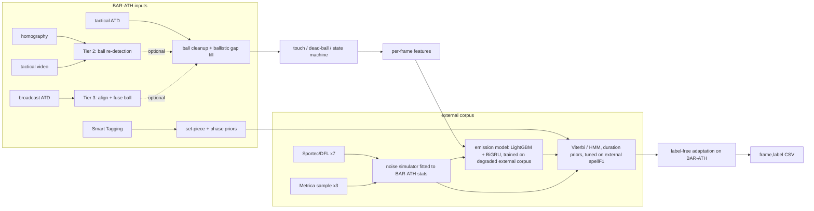

# Plan v2 — Ball Possession (BAR-ATH)

Supersedes `plan-possessionEnginePipeline.prompt.md`. Written against the rules as of commit `f8f2629`.

---

## 1. The decision

**Core system (what will produce the score):** a possession engine trained on *other matches* and decoded offline.

1. **Supervised learning on external corrected tracking** (Sportec/DFL ×7 with per-frame alive/dead + owning team, Metrica sample ×3 with events), **degraded to look like our automatic tracking** by a noise simulator fitted to BAR-ATH's unlabelled statistics.
2. **Physics/rule layer** (touches, ballistic gap filling, out-of-bounds, stationary-ball, set-piece priors) that is generic, needs no labels, and produces both features and hard constraints.
3. **Offline, bidirectional decoding** — we have the whole match, so every decision may use the future: the ball reappearing 2 s later tells us who received the pass 2 s ago. Viterbi/HMM with possession-duration priors, tuned directly on `spellF1` on held-out external matches.
4. **Label-free adaptation on BAR-ATH** (allowed: unsupervised / algorithmic pseudo-labels): Smart Tagging as weak priors, self-training, EM re-estimation of transition rates.

**Ball-recovery add-ons (only if a feasibility gate passes):** tactical-video ball re-detection (Tier 2), broadcast alignment + ball fusion (Tier 3). Both only *improve the ball input*; neither is on the critical path.

**LLMs: tooling, not the model.** Used where they are cheap, safe under the T&C and reproducible — writing code, generating candidate rules/labeling functions scored automatically on external data, and error analysis on *public* external matches. No LLM touches BAR-ATH data except an optional local-model experiment that must clear the ablation bar. Section 7 has the full decision table.

**Why this and not the alternatives**

| alternative | why not as the core |
|---|---|
| Rules only, tuned by eye | Thresholds tuned by watching BAR-ATH are "constants tied to the game" (RULES.md) and cannot be validated without labels; rules alone also handle the 41% missing-ball frames badly. |
| Train/tune on the public 5 min | Now explicitly banned; also 17 possessions cannot select anything. |
| Unsupervised only on BAR-ATH | No way to measure anything; H/A symmetry is unidentifiable without a prior. |
| LLM/VLM as the labeller | T&C forbid hosted models on the data; local VLMs are weak on a 6-px ball in a wide shot; 199k frames × anything is slow and non-reproducible. |
| External supervised + simulated noise (**chosen**) | The GT *is* "corrected tracking + owning-team flag", which is exactly what DFL/Metrica corrected data provides; the noise simulator is the one assumption, and it is testable (§5). |

---

## 2. Pipeline

---

## 3. Workstreams (3–5 people)

| # | workstream | owner | critical path? |
|---|---|---|---|
| W1 | Data & evaluation: loaders, external corpus, noise simulator, evaluator, reproducibility | 1 | **yes** |
| W2 | Possession engine: rules, features, emission models, decoder, adaptation | 1–2 | **yes** |
| W3 | Tier 2 tactical-video ball recovery (after feasibility gate) | 1 (CV) | no |
| W4 | Tier 3 broadcast alignment (after feasibility gate) — *drop first if only 3 people* | 0–1 | no |
| W5 | LLM tooling (rule search, error analysis), ablations, technical doc | shared / 5th | no |

---

## 4. Steps

### Phase 0 — Scaffolding (everyone, first two days) — **done 2026-10-27 in `../mtah-possession/`**
1. Public repo (data gitignored): `mtah/{paths,io,labels,baseline,config}.py` (flat layout; to add: `degrade, features, touches, deadball, model, decode, adapt, video_ball, broadcast_align`), `scripts/{check_data,make_submission,evaluate}.py` (to add: `build_corpus, train`), `configs/default.yaml`, `results/` (our submissions), `models/`, `docs/`, pinned `requirements.txt` + `pyproject.toml`, `Makefile` with `make submission`. **Everything organiser-origin lives unmodified under `vendor/mtah2027/`** (upstream layout kept so their scripts run as-is; MIT, see `NOTICE.md`): `games.py`, `evaluation/{possession_metrics,run_evaluation,validate_submission}.py`, public GT, baseline CSVs, `starter/{baseline,load_*}.py`. `mtah/paths.py` puts `vendor/mtah2027` and its `evaluation/` on `sys.path`.
2. `mtah.io.load_tracking()` → `Tracking(ball (N,3), players (N,46,3), team_of_slot (46,), fps, pitch, labels=None)` in metres (105.3×68); cached `cache/*.npz` (parse 7 s, load <1 s). External loaders will return the same object.
3. `scripts/evaluate.py` scores any `frame,label` CSV against any GT (`--gt path`, `--bootstrap`); `make board` runs the official scorer. Per-match LOO report: to add with the corpus.
4. Baseline reproduced through our loader and asserted **identical** to `baseline_raw` / `baseline_smooth50` (`tests/test_reference_baseline.py`); public smoke test 0.3256 / 0.6207 matches the published numbers. Data stats confirmed: ball visible 56.9% / 59.3% graded, 20.5 mean objects, 4.2% of visible graded ball frames out of bounds. **Note:** the ATD ball `speed` field is implausibly low (median 1.3 m/s, p95 4.3 m/s) — compute ball speed from positions, do not trust the field.

### Phase 1 — External corpus & noise simulator (W1; the foundation)
5. **Sportec/DFL open data** via `kloppy.sportec.load_open_tracking_data(match_id)` / `load_open_event_data(match_id)` for `J03WMX J03WN1 J03WPY J03WOH J03WQQ J03WOY J03WR9` (25 fps, per-frame `ball_state` + `ball_owning_team` → `H/A/D` directly; events carry set-piece qualifiers). Check and cite the licence.
6. **Metrica sample data** (`github.com/metrica-sports/sample-data`): game 3 in EPTS format (same as our ATD), games 1–2 CSV; derive `H/A/D` per frame algorithmically from events (possession = team of current sequence; `D` from BALL OUT / foul / goal until the next SET PIECE). Read `documentation/` — same provider, same conventions as the GT.
7. **Convention check (allowed use of the public window)**: compare how DFL's owning-team flag and our Metrica-event derivation treat interceptions, deflections, loose balls and restart timing against the *public GT's* conventions, by watching the public window with the ATD overlaid (homography `project()`). Output: a written convention list + any fix to the *external label derivation*. No BAR-ATH scores, no thresholds from this step.
8. **Synthesize the missing inputs for external matches**: set-piece instances from events (Type + team, with `N/A` team for throw-ins to mimic ours); optional coarse phase tags from ball zone + owning team with injected noise, so the model can learn to use Smart Tagging-like features.
9. **Noise simulator** `degrade.py`, fitted to BAR-ATH's **unlabelled** statistics: ball-dropout hazard as a function of ball speed, crowding (players within 3 m of last ball position) and distance to touchline; gap-length distribution; track fragmentation (slot lifetimes), anonymous slot assignment, duplicates, jitter (from second-difference residuals); measurement delay. Apply with several random seeds per match → effectively ×3–5 the corpus.
10. **Validate the simulator** (the one assumption of the whole plan): on degraded external matches, `baseline_smooth50` must score near its full-match BAR-ATH value (spellF1 0.24, macroF1 0.67), ball-visible ≈ 59%, mean tracked objects ≈ 20.5, nearest-player-to-ball distance distribution similar. Iterate the simulator until it does. **Gate 1 depends on this.**
11. **Optional third source** — SkillCorner open data (9 matches, *automatic* broadcast tracking with gaps, per-frame possession fields): closer to our noise profile but partial pitch coverage; use only if its possession/ball-status fields check out.

### Phase 2 — Possession engine (W2; always shippable)
12. *Ball cleanup*: Savitzky–Golay smoothing; speed / acceleration / heading; out-of-bounds flag with margin; **ballistic gap filling** — for gaps whose endpoints are consistent with one flight (speed and direction continuity), interpolate; otherwise keep endpoints only and record gap length.
13. *Touches*: acceleration spikes + heading changes → touch events; attribute to nearest player (≤ ~2 m) → team; per touch: speed before/after, distance to 2nd-nearest opponent (contest), zone.
14. *Receiver prediction during gaps*: from the last seen velocity, which players lie on the ball's ray over the next seconds, and who is nearest where it reappears → team prior for the gap, used bidirectionally.
15. *Dead-ball cues*: out-of-bounds; stationary ball + low collective speed; collective "reset" motion (both teams drifting toward formation, defenders retreating); tracked-object count changes; GK-hold vs stoppage disambiguation; Smart Tagging `SET PIECES`/`GOALS` (restart ends `D`; goal starts `D` until `Kick Off (After Goal)`); pre-kick-off block per half detected from `Kick Off (Start)` + both teams in own halves + ball at centre (the `games.py` kick-off frames are organiser-provided and serve as a cross-check).
16. *State machine*: team = team of last controlled touch; controlled = two consecutive same-team touches, or carry ≥ ~0.4 s, or speed drop after touch; deflections (speed kept, small heading change) do not flip; loose/contested → keep last team. **Thresholds fitted on the external corpus**, never on BAR-ATH.
17. *Features* (`features.py`), oriented by attacking direction so matches are interchangeable: distances ball→nearest H / A and 2nd nearest; ball speed/accel; time since last touch; last-touch team; touch-sequence counts; gap flag + length + position in gap; receiver-prediction team; team centroids, spread, mean speed, compactness, pitch-control proxy at the (estimated) ball; state-machine output; set-piece proximity; phase tag team one-hot (synthesized for external matches). **Augmentation**: swap H/A roles on every training match to remove home/away bias and double the data.
18. *Emission models*: (a) LightGBM 3-class on windowed features; (b) small BiGRU/TCN over per-frame features (bidirectional = uses the future). Leave-one-match-out CV on the degraded corpus; average the two if the ensemble clears the noise band.
19. *Decoder*: Viterbi over {H, A, D} with transition penalties (H↔A, H/A↔D) and a minimum-duration post-filter; optional explicit duration prior (semi-Markov) if short-possession recall is poor. **Tune directly on spellF1** of held-out external matches (grid or Optuna). Set-piece and phase priors enter as additive log-prior terms with conservative weights.
20. *Label-free adaptation on BAR-ATH* (each step validated by simulating it on a held-out external match first): EM re-estimation of transition rates; one round of self-training on high-confidence decoded spans; Smart Tagging weak labels via a label model (team-tagged phase interiors, away from boundaries).
21. *Output policy*: `X` outside the two graded blocks; **no `X` on graded frames** (Viterbi already gives continuity; `X` only costs macroF1). `make_submission.py` → `evaluation/results/<team>.csv` → `validate_submission.py`.

### Phase 3 — Tier 2: tactical-video ball recovery (W3; gate first)
22. **Feasibility gate (before any training)**: on a sample of missing-ball graded frames, is the ball plausibly visible in the tactical video (occluded in a crowd vs. simply undetected)? Estimate the ceiling: fraction of missing frames that are recoverable. Proceed only if the ceiling is worth it (rule of thumb: > ~15% of missing graded frames).
23. Auto-labels from frames where ATD ball exists, projected via homography; automatic quality filter (low speed, near player, low reprojection error). Inspect to *design* the filter, never to hand-pick samples. Optionally pre-train on public ball data from other games (SoccerNet).
24. Small detector (YOLOv8/11-n/s on tiles) → tracklets (Kalman) → inverse homography → pitch coords with source + confidence flags. Deterministic inference, quantised coordinates, committed weights.
25. Measure gain with the §5 protocol (simulate the achieved recovery pattern on external matches; on BAR-ATH only coverage and agreement proxies).

### Phase 4 — Tier 3: broadcast alignment (W4; gate first; first to cut)
26. **Feasibility gate**: broadcast ball visible 50.5%, homography valid 65.8%; estimate the *complementary* coverage — how many tactical-missing graded frames would have a valid broadcast ball after alignment? Proceed only if meaningful.
27. Shot segmentation (homography `valid` flips, matrix jumps); per-shot offset by cross-correlating team centroids, refined by Chamfer distance between per-team point sets; monotonic offset constraint per half; rejected shots stay rejected (no manual fixes).
28. Validate on frames where both balls exist (median disagreement < ~2 m); fuse broadcast ball where tactical ball is missing/implausible; feed into step 12.

### Phase 5 — Ablation, freeze, reproduce
29. Ablation table on held-out external matches with bootstrap CIs: rules-only → +GBM → +BiGRU → +decoder tuning → +adaptation → +Tier 2 → +Tier 3 → +LLM components. Keep an addition only if it clears ~0.04 spellF1.
30. Freeze config and weights; fresh clone on a second machine → `make submission` → `diff` identical; `validate_submission.py` on the exact upload.

### Phase 6 — Deliverables
31. Technical doc: approach and why; assets used/dropped; **training data** (each external dataset: source, licence, who labelled, how many frames; none from BAR-ATH); noise simulator and its validation; possession rules; missing-ball handling; LLM components and how their outputs are reproducible; public-window protocol; limitations; reproduction command.
32. Submit `<team>.csv`, repo URL, `<team>.pdf`.

---

## 5. Evaluation protocol (how we decide anything)

| level | data | used for |
|---|---|---|
| **Primary** | leave-one-match-out on the *degraded* external corpus, official scorer, bootstrap CIs | every model/threshold/ablation decision |
| **Secondary (label-free, on BAR-ATH)** | agreement with Smart Tagging team tags inside phase interiors; possession count / mean duration / D share vs. the external distribution; ATD–video–broadcast ball agreement | sanity and domain-shift detection, not selection |
| **Smoke test** | public 5 min, run once per gate | alignment, label semantics, D recall ≫ 0.21, pre-kick-off `D` block, no absurd counts. Record the number; never select on it. Protocol written in the repo. |

---

## 6. Gates (deadline Nov 17)

| gate | by | must be true |
|---|---|---|
| **G0** | Oct 29 | repo + loaders + evaluator; external corpus loads; baselines reproduced on BAR-ATH and run on raw external matches |
| **G1** | Nov 3 | noise simulator validated (step 10); rules v1; **first valid submission**; feasibility numbers for Tier 2 and Tier 3 |
| **G2** | Nov 9 | emission models + tuned decoder beat the baseline on held-out external beyond the CI; ablation table started; go/no-go on Tier 2, Tier 3, adaptation, LLM experiments |
| **G3** | Nov 13 | fusion frozen; second-machine reproduction identical; doc draft |
| **Submit** | Nov 15–16 | final validation of the exact file; Nov 17 is buffer only |

---

## 7. LLMs — decision table

Constraints: the T&C forbid sending any competition data, video or extract to a hosted LLM; the submission must be byte-exactly reproducible; LLM use is not scored.

| use | data exposure | runs where | expected value | decision |
|---|---|---|---|---|
| **Development copilot** — rule engine, simulator, HMM, tests, doc; enumerate what `possession_metrics.py` rewards/penalises | code only | hosted OK | high, certain | **do** |
| **LLM-generated labeling functions / features** — LLM writes candidate possession heuristics as Python from CHALLENGE.md's definitions; an automatic loop scores each on the *external* corpus and feeds back only scores; survivors become features or weak-label voters (Snorkel-style label model) | code + scores from public external matches | hosted OK | medium; cheap (dozens of calls) | **do** — this is the legitimate "LLM for training data": pseudo-labels produced by an algorithm, never by a person |
| **LLM error analysis / validation on external matches** — feed symbolic logs (touch sequences, predicted vs. true labels) of missed/spurious transitions; ask for failure-mode clustering and feature proposals | public external data only | hosted OK (not competition data) | medium | **do** at G2 |
| **Property tests for derived labels** — LLM writes invariants (no team change inside `D`, `D` after ball-out until set piece, …) run over the external corpus | code only | hosted OK | medium | **do** |
| **Local LLM adjudication of ambiguous windows** on BAR-ATH — symbolic touch log of only the few hundred windows where rules and model disagree; answer enters the decoder as one emission term; temperature 0, fixed seed, outputs cached in repo | competition data | **local open-weight only** (Qwen/Llama 7–14B on M1/GPU) | low–medium, uncertain | **experiment** after G2; keep only if it clears the ablation bar; ask organisers whether cached outputs satisfy rule 3 |
| Local VLM on sparse keyframes at candidate dead-ball boundaries | competition data | local only | low (6-px ball in wide shot) | **skip** unless Tier 3 alignment gives broadcast close-ups |
| LLM/VLM as the per-frame labeller; any clip/CSV/extract to a hosted model | — | — | — | **never** |

Bottom line: if external supervised + rules win the ablations, that is what ships and the LLMs will have been a productivity multiplier. Nothing in the scoring rewards an LLM for being there.

---

## 8. Rules-compliance checklist (for the technical doc)

- [ ] No hand labels, corrections or frame-specific constants on BAR-ATH anywhere (submission, training, validation, tuning).
- [ ] Public 5 min used only as a correctness smoke test; protocol documented.
- [ ] No human-produced data about BAR-ATH from any source (event feeds, corrected tracking).
- [ ] Every external dataset listed with source, licence, who labelled it, how much.
- [ ] Any LLM component: model, version, prompt, determinism settings, cached outputs; hosted models never saw competition data.
- [ ] Repo regenerates the exact CSV from the data bundle on a clean machine; weights committed; no match data or derived frame-level exports in the repo.
- [ ] Training on cloud GPUs only if the signed terms allow uploading the data there; otherwise M1 / own machine.

---

## 9. Risks and mitigations

1. **Noise simulator is wrong** → everything trained on it transfers badly. Mitigation: step 10 validation against baseline scores and unlabelled statistics; the rule layer and bidirectional decoder are noise-robust by design; adaptation (step 20) closes residual shift.
2. **Convention mismatch between DFL/Metrica labels and the GT** (e.g. when possession flips on a loose ball). Mitigation: step 7 convention check; prefer Metrica-event-derived labels where the two disagree, since the GT comes from Metrica's corrected tracking.
3. **Tier 2/3 consume the schedule**. Mitigation: feasibility gates before any training; G2 go/no-go; Tier 3 is the first cut with a 3-person team.
4. **GPU non-determinism breaks byte-exact reproduction**. Mitigation: GBM/Viterbi on CPU; detector inference deterministic + quantised; committed weights; second-machine diff at G3.
5. **Seeing the public score biases choices**. Mitigation: one run per gate, logged; selection only on external held-out.
